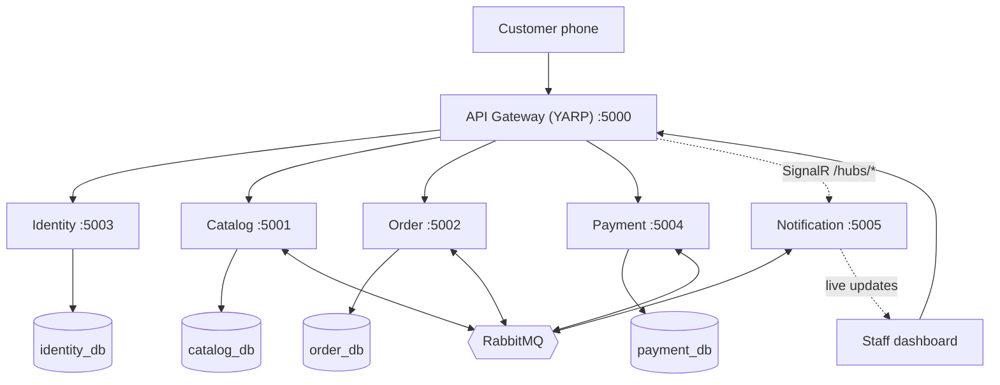
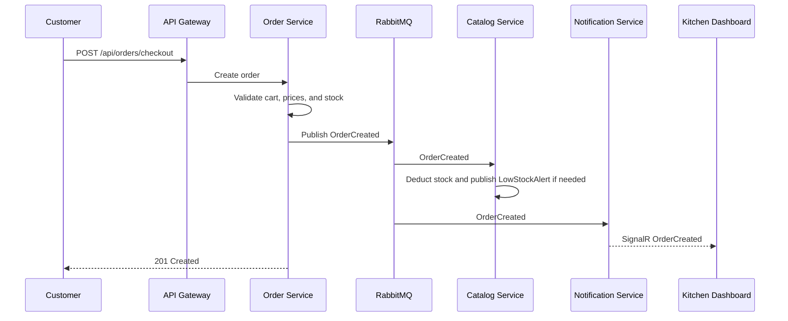

<div align="center">

# Restaurant POS & Ordering System

**A microservices-based point of sale and QR ordering system for small and medium restaurants.**

[](https://dotnet.microsoft.com/)
[](https://nextjs.org/)
[](https://www.postgresql.org/)
[](https://www.rabbitmq.com/)
[](https://www.typescriptlang.org/)
[](https://www.docker.com/)

[](#project-status)
[](#license)

[Features](#features) | [Architecture](#architecture) | [Tech Stack](#tech-stack) | [Getting Started](#getting-started) | [Documentation](#documentation) | [Roadmap](#roadmap)

</div>

---

## Overview

A single-URL restaurant POS and ordering system that serves two flows from the same domain:

1. **Customer (public, no login):** scan a table QR code, browse the menu, customize items, and place an order.
2. **Staff (private, login):** one dashboard for live orders, kitchen display, cashier payments, and admin.

The system is designed for small teams that cannot staff separate owner and kitchen roles. It
uses an event-driven microservices architecture so each service can evolve independently.

### Why this design

- **Zero customer friction:** no app download, no account, no password.
- **One dashboard for small teams:** owner and kitchen share a live order queue.
- **Real-time by default:** new orders reach the kitchen in under a second through SignalR.
- **Mobile-first:** optimized for mid-range Android phones on restaurant Wi-Fi.
- **Independent services:** menu, orders, payments, and notifications deploy separately.
- **Scalable:** runs on one location today and can grow to many.

---

## Features

| Area | Capabilities |
| --- | --- |
| **Customer menu** | QR table entry, category browsing, product modifiers, live cart totals, order submission, order status tracking |
| **Kitchen display (KDS)** | Live order queue, one-tap status changes, elapsed-time warnings, sold-out toggles, large touch targets |
| **Cashier** | Pending payments, cash with change calculation, QR slip upload and verification, receipt printing |
| **Admin** | Staff and roles, table and QR management, full menu CRUD, order oversight, sales reports, audit logs, settings |

### Order lifecycle

```text
PENDING -> COOKING -> READY -> COMPLETED

CANCELLED can occur from PENDING, COOKING, or READY.
```

### Payment lifecycle

```text
PENDING -> PENDING_VERIFICATION -> COMPLETED

PENDING or PENDING_VERIFICATION -> FAILED
COMPLETED -> REFUNDED
```

---

## Architecture

The API Gateway is the only client entry point. Services own their data and communicate through
RabbitMQ events. Real-time updates are pushed from the Notification Service over SignalR.



### Services

| Service | Port | Database | Responsibility |
| --- | --- | --- | --- |
| **API Gateway** (YARP) | 5000 | none | Routing, rate limiting, CORS, JWT pre-validation, logging |
| **Identity** | 5003 | `identity_db` | Login, JWT, roles, audit logs |
| **Catalog** | 5001 | `catalog_db` | Categories, products, modifiers, stock, sold-out status |
| **Order** | 5002 | `order_db` | Tables, carts, orders, status transitions |
| **Payment** | 5004 | `payment_db` | Cash, QR, slip upload, verification, refunds |
| **Notification** | 5005 | none | SignalR hubs and live updates |

### Order flow



### Events

| Event | Published by | Consumed by | Effect |
| --- | --- | --- | --- |
| `OrderCreated` | Order | Catalog, Notification | Deduct stock, push order to kitchen |
| `OrderStatusChanged` | Order | Notification | Update customer tracking |
| `LowStockAlert` | Catalog | Notification | Alert manager |
| `ProductCreated` / `ProductUpdated` | Catalog | Catalog consumers | Sync menu data |
| `PaymentCompleted` | Payment | Order, Notification | Complete order, notify staff |

---

## Tech Stack

| Layer | Technology |
| --- | --- |
| **Frontend** | Next.js 14+ (App Router), React 18+, TypeScript strict mode, Tailwind CSS, shadcn/ui, Zustand, React Query, SignalR client |
| **Backend** | .NET 10, C# 12+, Minimal APIs, Entity Framework Core, FluentValidation, MassTransit |
| **Messaging** | RabbitMQ 3.13 with MassTransit |
| **Gateway** | YARP reverse proxy |
| **Real-time** | SignalR (WebSocket) |
| **Database** | PostgreSQL 16, one database per service |
| **Infrastructure** | Docker, Docker Compose, Terraform, GitHub Actions |
| **Observability** | OpenTelemetry, Prometheus, Grafana |

---

## Repository Structure

```text
restaurant-pos/
|-- apps/
|   `-- frontend/                 # Next.js customer menu and staff dashboard
|-- services/
|   |-- ApiGateway/               # YARP gateway, port 5000
|   |-- IdentityService/          # port 5003
|   |-- CatalogService/           # port 5001
|   |-- OrderService/             # port 5002
|   |-- PaymentService/           # port 5004
|   `-- NotificationService/      # port 5005
|-- infra/
|   |-- docker-compose.yml
|   |-- postgres/init/        # creates the four service databases
|   `-- terraform/
|-- .github/workflows/        # CI (GitHub only reads workflows from the repo root)
|-- scripts/                  # dev-setup, run-all, smoke-test, make-phase-zip
|-- tests/
|   `-- IdentityService.Tests/
|-- docs/
|   `-- AI_CONTEXT_FULL.md        # Full specification
|-- AI_CONTEXT.md                 # Compact specification
|-- CLAUDE.md                     # AI and contributor rules
|-- SKILL.md                      # Skill routing
|-- AGENTS.md                     # Agent entry point
`-- README.md
```

---

## Project Status

> **Phase 1 is built.** The API Gateway, Identity Service, Docker Compose, CI, and Terraform
> foundation exist. Phases 2-6 (Catalog, Order, frontend, payments, hardening) are not built yet.
> See [docs/PHASE_1_NOTES.md](./docs/PHASE_1_NOTES.md) and [docs/PHASE_1_RUNBOOK.md](./docs/PHASE_1_RUNBOOK.md).

| Milestone | Status |
| --- | --- |
| Product specification and AI context | Complete |
| Architecture, API, and schema design | Complete |
| Phase 1: Foundation and infrastructure | Built (verify with the runbook) |
| Phase 2: Core business services | Not started |
| Phase 3: Public customer menu | Not started |
| Phase 4: Staff dashboard | Not started |
| Phase 5: Payments and admin | Not started |
| Phase 6: Testing and production | Not started |

---

## Getting Started

### Prerequisites

| Tool | Version |
| --- | --- |
| Docker Desktop | Latest |
| Node.js | 20+ |
| .NET SDK | 10 |
| Git | Latest |

### Local setup (Windows PowerShell)

```powershell
# from the repository root
.\scripts\dev-setup.ps1      # creates .env, builds, creates the DB migration, starts PostgreSQL + RabbitMQ
.\scripts\run-all.ps1        # starts the Gateway (5000) and Identity Service (5003)
.\scripts\smoke-test.ps1     # checks login, refresh, RBAC, and user management through the gateway
```

Full steps and troubleshooting: [docs/PHASE_1_RUNBOOK.md](./docs/PHASE_1_RUNBOOK.md).

### Endpoints

| Service | URL | Status |
| --- | --- | --- |
| API Gateway | <http://localhost:5000> | Phase 1 |
| Identity Service (direct) | <http://localhost:5003> | Phase 1 |
| RabbitMQ Management | <http://localhost:15672> | Phase 1 |
| PostgreSQL | `localhost:5432` (see `POSTGRES_HOST_PORT`) | Phase 1 |
| Frontend | <http://localhost:3000> | Phase 3 |

--- | --- |
| Frontend | <http://localhost:3000> |
| API Gateway | <http://localhost:5000> |
| RabbitMQ Management | <http://localhost:15672> |
| PostgreSQL | `localhost:5432` |

---

## Documentation

| Document | Status | Purpose |
| --- | --- | --- |
| [README.md](./README.md) | Available | Project overview |
| [AI_CONTEXT.md](./AI_CONTEXT.md) | Available | Compact specification: flows, services, schemas, API |
| [docs/AI_CONTEXT_FULL.md](./docs/AI_CONTEXT_FULL.md) | Available | Full original specification |
| [CLAUDE.md](./CLAUDE.md) | Available | Hard rules for AI agents and contributors |
| [SKILL.md](./SKILL.md) | Available | Skill routing for AI-assisted work |
| [AGENTS.md](./AGENTS.md) | Available | Agent entry point and read order |
| `PROJECT.md` | Planned | Business requirements and phases |
| `ARCHITECTURE.md` | Planned | Detailed technical design |
| `DEVELOPMENT.md` | Planned | Coding standards and git workflow |
| `API.md` | Planned | Endpoint reference with examples |
| `DATABASE.md` | Planned | Schemas, relationships, migrations |
| `UX_UI.md` | Planned | Design system and accessibility |
| `SECURITY.md` | Planned | Threat model and mitigations |
| `TESTING_STRATEGY.md` | Planned | Test pyramid and quality gates |
| `INFRASTRUCTURE.md` | Planned | DevOps and deployment |
| `ONBOARDING.md` | Planned | New developer quick start |

---

## Security

- JWT access tokens (15 minutes) held in memory, refresh tokens (7 days) in HttpOnly Secure cookies.
- Role-based access control validated at the gateway and at each service.
- Parameterized queries only; Entity Framework Core by default, raw SQL forbidden without review.
- Rate limiting on public order and payment-slip endpoints.
- Payment slips treated as untrusted uploads and verified by a cashier or manager.
- HTTPS, CSP, and strict CORS enforced in production.
- Audit logging for all sensitive actions.
- No secrets in source; environment variables only.

---

## Roadmap

- [x] Business requirements and user flows
- [x] Microservices architecture and data model
- [x] API contracts and event definitions
- [x] AI context and contributor rules
- [x] Phase 1: Repository, Docker Compose, YARP gateway, Identity Service, CI/CD
- [ ] Phase 2: Catalog, Order, RabbitMQ events, SignalR, migrations
- [ ] Phase 3: Public mobile menu with SSR and cart
- [ ] Phase 4: Staff dashboard, KDS, menu and table management, receipt printing
- [ ] Phase 5: Payment Service, admin reports, audit logs, QR generation
- [ ] Phase 6: Tests, load testing, monitoring, security audit, production deploy

---

## Testing and Quality Gates

| Layer | Share | Tools |
| --- | --- | --- |
| Unit | 70% | xUnit, Moq, FluentAssertions, Vitest |
| Integration | 20% | Testcontainers, service-level tests |
| End-to-end | 10% | Playwright |

Merge is blocked when coverage drops below 80%, an E2E test fails, or lint reports errors.
Critical paths under test: cart calculation, stock deduction, order transitions, RBAC, and
payment verification.

---

## Contributing

1. Create a branch: `feature/POS-123-add-modifier-support`.
2. Commit with [Conventional Commits](https://www.conventionalcommits.org/): `feat(order): add order notes`.
3. Open a pull request and request review.
4. Address feedback and squash merge.

Checklist:

- [ ] Code follows the project style.
- [ ] Tests added or updated.
- [ ] Documentation updated.
- [ ] No security regressions.
- [ ] Performance considered.

---

## License

Proprietary software. All rights reserved.
